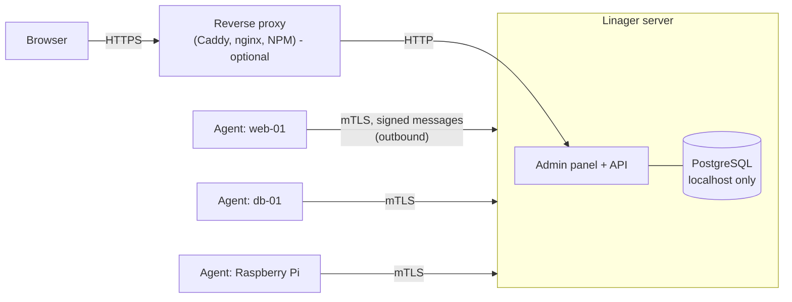

<div align="center">


# Linager

**Open-source server management for Debian, Ubuntu and Windows.**
One web panel, a lightweight agent on every host: live metrics, terminal, files, services, apt, firewall, Docker, a remote screen (RDP and the Assistant for Windows and Linux), a Console view for many sessions at once, and signed self-updates.

[](https://github.com/bolgov0zero/linager/releases/latest)
[](https://github.com/bolgov0zero/linager/actions/workflows/ci.yml)
[](LICENSE)
[](go.mod)


**English** · [Русский](README.ru.md)

[**Website**](https://bolgov0zero.github.io/linager/) · [Features](#features) · [Screenshots](#screenshots) · [Install](#install) · [How it works](#how-it-works) · [Documentation](#documentation)

<picture>
  <source media="(prefers-color-scheme: dark)" srcset="docs/screenshots/en/dashboard-dark.png">
  
</picture>

</div>

## Why Linager

- **One binary, two roles.** `linager` is the server (admin panel + API) or the agent, picked at install time. No Docker, no Kubernetes, no cloud account. PostgreSQL runs locally next to the server.
- **Agents connect out.** The agent dials the server over mutual TLS, so managed hosts need no open inbound port. Every message is signed.
- **Safe by design.** Network and firewall edits are applied with a 30-second rollback timer that lives **on the agent**, so a bad rule that cuts the connection undoes itself. Dangerous actions ask for confirmation, and everything an administrator does lands in an audit log.
- **Small footprint.** The server runs on Debian and Ubuntu (amd64), the agent also on arm64 (Raspberry Pi 4, 64-bit OS). The web interface is embedded in the binary.
- **Linux and Windows in one panel.** The Windows agent (10/11, Server 2016+) gives metrics, a terminal, services, users, Windows Update and a **remote desktop right in the browser**.
- **The screen of a host in the browser.** RDP through the panel for Windows (nothing to install, port 3389 stays closed) and the **Assistant**: the console of a Windows or Linux (GNOME on Wayland) computer, with the sign-in screen, the lock screen and UAC, with no new session and without pushing the person at the computer out. Everything opens in the **Console** view: the servers on the left, the sessions in tabs.
- **Russian and English**, light and dark themes, and a separate phone layout: a bottom bar, cards and a server page made for a thumb.

## Features

| | |
|---|---|
| **Dashboard** | Cards, a grid or the Console, a Linux or Windows badge, groups, filters, search by name or IP. CPU, RAM, disk, network, uptime, pending updates, reboot needed, failed services at a glance. The view switch, "+ Server" and the menu (theme, language, edit, settings, log out) live in the top bar; on a server page the same bar carries its name, state, note, reboot and delete. |
| **Console** | The third view of the dashboard next to Cards and Grid: a list of servers by group on the left (a switch decides what a click opens: Terminal, RDP or Assistant), the live sessions in tabs on top, the state is remembered. Floating windows (terminals, Files, Dispatcher) stay on top and are listed in the side list. Many servers on one screen without a dozen browser tabs. |
| **Assistant** | The screen of a computer and its control in the browser: the mouse, the keys, the text clipboard, a choice of monitor. **Windows** (Home too): the console or the session of another user, the lock screen, sign-in and UAC, Ctrl+Alt+Del. **Linux** (GNOME on Wayland): the desktop, and below the compositor the GDM sign-in screen, the lock screen and X11. No new session and no question to the person at the computer; every opening goes to the audit log. The picture is set in the "Management" tab: presets, colours, frame rate, traffic limit. |
| **RDP** | A Windows remote desktop in the page or in a floating window. The client is part of the panel (WebAssembly), nothing to install, port 3389 stays closed: the connection goes through the agent. Clipboard both ways, the resolution follows the window, Ctrl+Alt+Del; on a Mac Cmd works as Ctrl. You sign in with a Windows account, the password is not stored. |
| **Dispatcher** | Processes and services in a floating window like the Task Manager, for Windows and Linux: search, sorting, end or force end, start, restart, stop. It opens from a button on the bar of any connection, next to **Files**. |
| **Keys** | A personal encrypted file of logins and passwords (Argon2id, AES-256-GCM), made and opened in the browser and never stored on the server. Fills the RDP form and types into the sign-in screen and UAC of the Assistant. Details: [docs/en/keys.md](docs/en/keys.md). |
| **Windows** | An agent for Windows 10/11 and Server 2016+ (MSI, a service): metrics, a PowerShell terminal, **RDP** and the **Assistant** in the browser (nothing to install), services, processes, event logs, files, disk, users and sessions, Windows Update, network settings with a rollback. Installed by one PowerShell command from a link. Details: [docs/en/windows.md](docs/en/windows.md). |
| **Metrics** | Live values every 5 seconds and history up to 360 days, charts for CPU, RAM, disk and network, events and reboots on the chart, CSV export, synchronized hover across charts. |
| **Terminal** | A web terminal on the host through the agent: floating windows, a key panel for phones, shared snippets, start the shell as another user. |
| **Files** | An explorer with a folder tree, multiple selection, copy, move, zip, `chmod` and `chown`, and an editor with syntax highlighting (CodeMirror 6). |
| **Updates (apt)** | Check and install everything or security updates only, per-package status and progress, console output on demand. A closed tab does not interrupt the installation. Single packages can be ignored: they stay in the list but are left out of the counters. |
| **Services and processes** | systemd services (start, stop, restart, autostart), top processes, a live journal. |
| **Network and firewall** | Interfaces, DNS, routes (ifupdown; netplan is view-only) and nftables with address lists, a port overview and a log. Edits pile up in a draft and are applied with an automatic 30-second rollback. |
| **Security** | SSH overview for 7 days, password-guessing attempts, `authorized_keys` audit, fail2ban install and management, ending remote sessions, local accounts of a host. |
| **Docker** | Containers, images, logs, start and stop, "check for newer images", update an image or a whole compose project with a rollback, **edit a container** (name, image, restart policy, command, ports, volumes, variables, limits; what can change in place does, the rest recreates the container with a rollback on failure), ignore updates of single containers. |
| **Disk** | Partitions, a fill-up forecast, what takes the space, safe cleanup (journal, apt cache, unused images, old kernels). |
| **Roles and sign-in** | Administrator, operator (chosen servers and modules) and auditor (read-only). Password with 2FA (TOTP, recovery codes) or a passkey. |
| **Admin access control** | A white or black list by real client address and by DDNS name, trusted reverse proxies, an access journal. |
| **Adding servers** | Three ways: confirm a key shown by the installer, an **install link** (one command on the new host, for Linux and for Windows, the signed release comes from your server, one click or none to approve), or an **install over SSH** from the panel (checks, stages, output, rollback on failure). |
| **Self-update** | Signed releases (minisign), a database backup before the update, automatic rollback, staged rollout to agents. |

Details per module: [docs/en/modules.md](docs/en/modules.md). History of changes: [CHANGELOG.md](CHANGELOG.md).

## Screenshots

The screenshots use demo data: fictional servers and documentation addresses.

### Console, Assistant and Dispatcher

The screens of the Assistant in these shots are a picture drawn by the demo simulator, not a real desktop.


<sub><b>Console.</b> A side list of servers, tabs of live sessions: a terminal, RDP and the Assistant side by side.</sub>

<table>
<tr>
<td width="50%"><br><sub><b>Assistant, Windows.</b> The screen of the console or of another user's session; no new session, nobody is pushed out.</sub></td>
<td width="50%"><br><sub><b>Assistant, Linux.</b> The GNOME desktop on Wayland, the sign-in and lock screens included.</sub></td>
</tr>
<tr>
<td width="50%"><br><sub><b>Management.</b> Presets, colours, frame rate, traffic limit; RDP on and off; the sessions of Windows.</sub></td>
<td width="50%"><br><sub><b>Dispatcher.</b> Processes and services in a floating window, on Windows and Linux.</sub></td>
</tr>
</table>

### Server page and metrics


### Terminal, files, updates

<table>
<tr>
<td width="50%"><br><sub><b>Terminal.</b> Snippets, key panel, floating windows.</sub></td>
<td width="50%"><br><sub><b>Files.</b> Explorer and an editor with syntax highlighting.</sub></td>
</tr>
<tr>
<td width="50%"><br><sub><b>Updates.</b> Per-package status and overall progress.</sub></td>
<td width="50%"><br><sub><b>Docker.</b> Containers, images, compose projects, image updates.</sub></td>
</tr>
</table>

### Firewall, security, accounts

<table>
<tr>
<td width="50%"><br><sub><b>Firewall.</b> A draft, then apply with a 30-second rollback on the agent.</sub></td>
<td width="50%"><br><sub><b>Security.</b> SSH overview, fail2ban, keys, sessions.</sub></td>
</tr>
<tr>
<td width="50%"><br><sub><b>Users.</b> Local accounts of a host with a terminal as the user.</sub></td>
<td width="50%"><br><sub><b>Network.</b> Interfaces, DNS, routes; changes roll back on their own.</sub></td>
</tr>
</table>

### Windows and adding servers

<table>
<tr>
<td width="50%"><br><sub><b>Windows.</b> The same server page with Windows tabs: RDP, Assistant, services, users.</sub></td>
<td width="50%"><br><sub><b>Disk.</b> Volumes, a fill-up forecast, cleanup (temp files, the Windows Update cache, <code>Windows.old</code>).</sub></td>
</tr>
<tr>
<td width="50%"><br><sub><b>Users and sessions.</b> Local accounts, groups, ending a session.</sub></td>
<td width="50%"><br><sub><b>+ Server.</b> An install link for Linux and Windows, install over SSH, confirm a key.</sub></td>
</tr>
<tr>
<td width="50%"><br><sub><b>RDP.</b> The sign-in form of the remote desktop; the client is part of the panel.</sub></td>
<td width="50%"><br><sub><b>Windows Update.</b> Updates, their kind and size, a restart when one is pending.</sub></td>
</tr>
</table>

### Docker: editing a container


Every field is marked "in place" or "recreate". Before applying, the window lists the changes; if the recreated container does not start, the old one comes back.

### Admin panel access

Open the panel only to the networks you use. Pick a **white list** (whatever is not listed is refused) or a **black list** (whatever is not listed is allowed). Behind a reverse proxy such as Nginx Proxy Manager, add the proxy to **trusted proxies**: the real visitor address then comes from `X-Forwarded-For`, and only from those proxies, so it cannot be forged. Clients on the local network can still connect directly. The panel refuses any setting that would lock you out.


The access journal records page opens, sign-ins and refused requests with the client address and the proxy it came through. One click puts an address into the list.


Locked yourself out anyway? Run `sudo linager access reset` on the server: the restriction goes off, the lists stay.

### On a phone

A separate phone layout: server cards and a server page with big buttons, a bottom bar with the sections and "More".

<table>
<tr>
<td width="50%" align="center"></td>
<td width="50%" align="center"></td>
</tr>
</table>

## Install

On a clean Debian or Ubuntu server, as root:

```bash
curl -fsSL https://raw.githubusercontent.com/bolgov0zero/linager/main/install.sh | sh
```

The wizard asks **Server** or **Client**, then sets up PostgreSQL, the keys, the administrator account and a systemd service. When it ends, the **Linager menu** opens (press Enter): the state of the host and numbered actions, the same as typing `linager` ([docs/en/menu.md](docs/en/menu.md)). Prefer to look first? Download, verify and run it yourself: [docs/en/install.md](docs/en/install.md).

**Add a managed host** ("+ Server" in the panel), three ways:

- **Confirm a key.** Run the same command on the host, pick **Client**, enter the server address. The agent shows a key and a check code; confirm it in the panel and the agent receives its certificate.
- **Install by a link.** The panel makes a link (lifetime, number of servers, optional networks and group) and shows a command for the new host. For Linux it runs as root, with no `sudo` and no `curl` needed:

  ```bash
  wget -nv -O- --no-check-certificate --pinnedpubkey 'sha256//…' 'https://panel.example.com:9443/v1/join/lk_…' | sh
  ```

  The agent comes from the cached, signed release of **your server** (no GitHub), the key of the server is pinned in the command, and the host appears in the panel for one click, or at once when the link approves itself. The name is taken from the agent. For Windows the "Linux / Windows" switch shows a PowerShell command (as administrator): it downloads the MSI from your server, checks it against the signed release and starts the service.
- **Install over SSH.** Enter the address, login and password (or a key) of the new host: the panel shows its host key, checks the system, the rights (asks for the `sudo` password when needed) and whether the host can reach the server, installs the agent, shows the stages and the output, and rolls the host back if the agent does not connect. Passwords live only in memory.

After either install the Linager menu opens on the new host. Details and the security notes: [docs/en/install.md](docs/en/install.md).

| | Server | Agent |
|---|---|---|
| Debian 12, 13 · Ubuntu 22.04, 24.04, 26.04 | amd64 | amd64, arm64 |
| Windows 10 / 11, Server 2016+ | — | amd64 (MSI), see [docs/en/windows.md](docs/en/windows.md); no firewall, security or Docker |
| Init system | systemd | systemd (Windows: service) |

The Assistant for Linux needs GNOME on Wayland (the Ubuntu Desktop default) and somebody signed in at the screen or the sign-in screen showing; the Assistant for Windows works on Windows 10/11 and Server, Home included; RDP needs Pro, Enterprise or Server.

The panel can run behind Caddy (Let's Encrypt is set up by the installer) or behind your own reverse proxy: [docs/en/proxy.md](docs/en/proxy.md) has examples for nginx, Caddy and Nginx Proxy Manager.

## How it works



- The **server** keeps the data in a local PostgreSQL and serves the panel. The client port (default `9443`) is for agents only and does not go through the proxy.
- The **agent** opens an outgoing WSS connection with a certificate issued at pairing, pins the server fingerprint and reconnects by itself. Modules (terminal, files, network and others) can be switched off in `/etc/linager/agent.yaml`.
- Pairing shows a short check code on both sides, so a man-in-the-middle cannot slip in.

## Security

- mTLS between the server and agents; signed messages; the server fingerprint is pinned by the agent.
- Passwords hashed with Argon2id, optional mandatory 2FA, passkeys, recovery codes, login rate limits.
- Dangerous actions need an explicit confirmation on the server; the agent refuses them without it.
- Network and firewall changes roll back on their own unless you confirm them within 30 seconds.
- An audit log of every administrator action, with the connection address and the address from `X-Forwarded-For`.
- Releases are signed with minisign, the public key is embedded in the binary; a database copy is made before every update.
- Secrets have permissions 600; the service runs as an unprivileged user with systemd sandboxing.

Details and known limits: [docs/en/security.md](docs/en/security.md). To report a vulnerability, see [SECURITY.md](SECURITY.md).

## Documentation

| Topic | English | Русский |
|---|---|---|
| Installation | [install](docs/en/install.md) | [установка](docs/ru/install.md) |
| Reverse proxy (Caddy, nginx, NPM) | [proxy](docs/en/proxy.md) | [прокси](docs/ru/proxy.md) |
| Admin panel access | [access](docs/en/access.md) | [доступ к админке](docs/ru/access.md) |
| Agent and application ports | [connection](docs/en/connection.md) | [подключение](docs/ru/connection.md) |
| Agent modules and configuration | [modules](docs/en/modules.md) | [модули](docs/ru/modules.md) |
| Updates, backups, rollback | [updates](docs/en/updates.md) | [обновления](docs/ru/updates.md) |
| Terminal menu (`linager`) | [menu](docs/en/menu.md) | [меню](docs/ru/menu.md) |
| The Console view | [console](docs/en/console.md) | [консоль](docs/ru/console.md) |
| Keys (a personal encrypted file of logins and passwords) | [keys](docs/en/keys.md) | [ключи](docs/ru/keys.md) |
| Security | [security](docs/en/security.md) | [безопасность](docs/ru/security.md) |
| Architecture | [architecture](docs/en/architecture.md) | [архитектура](docs/architecture.md) |

The documentation is also published as a site: <https://bolgov0zero.github.io/linager/>. The interface design and mockups are in [docs/design/](docs/design/).

## Development

```bash
make web && make build      # frontend (Svelte 5 + Vite) and the linux/amd64 and linux/arm64 binaries
make test                   # go vet + tests (set LINAGER_TEST_DSN for the PostgreSQL end-to-end tests)
cd web && npm run dev       # UI with hot reload, proxies /api to a local server on 127.0.0.1:18080
```

Go, a single `linager` binary (`server`, `agent`, `install`, `update`, `backup`, `restore`, `access`), PostgreSQL, the frontend embedded with `go:embed`. Issues and pull requests are welcome.

## License

[Apache-2.0](LICENSE). The Medeo fonts are under SIL OFL 1.1 ([docs/design/mockup/fonts/](docs/design/mockup/fonts/)).
