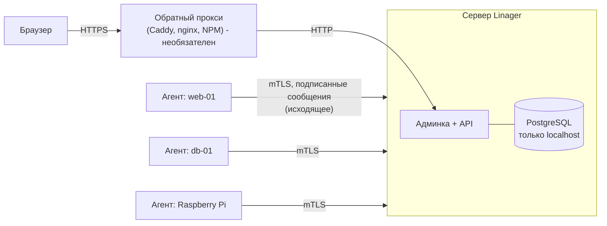

<div align="center">


# Linager

**Открытая система управления серверами на Debian, Ubuntu и Windows.**
Одна веб-админка и лёгкий агент на каждом сервере: метрики в реальном времени, терминал, файлы, службы, apt, файрвол, Docker, удалённый экран (RDP и Помощник для Windows и Linux), вид «Консоль» для многих сеансов сразу и подписанные обновления самой системы.

[](https://github.com/bolgov0zero/linager/releases/latest)
[](https://github.com/bolgov0zero/linager/actions/workflows/ci.yml)
[](LICENSE)
[](go.mod)


[English](README.md) · **Русский**

[**Сайт**](https://bolgov0zero.github.io/linager/ru/) · [Возможности](#возможности) · [Скриншоты](#скриншоты) · [Установка](#установка) · [Как это устроено](#как-это-устроено) · [Документация](#документация)

<picture>
  <source media="(prefers-color-scheme: dark)" srcset="docs/screenshots/ru/dashboard-dark.png">
  
</picture>

</div>

## Почему Linager

- **Один бинарник, две роли.** `linager` — это сервер (админка и API) или агент, роль выбирается при установке. Без Docker, Kubernetes и облачных аккаунтов. PostgreSQL работает локально рядом с сервером.
- **Агенты подключаются сами.** Агент устанавливает исходящее соединение с сервером по взаимному TLS, поэтому на управляемых серверах не нужен открытый входящий порт. Все сообщения подписаны.
- **Безопасность по умолчанию.** Правки сети и файрвола применяются с таймером отката на 30 секунд, который работает **на агенте**: ошибочное правило, оборвавшее связь, отменяется само. Опасные действия требуют подтверждения, всё, что делает администратор, пишется в журнал аудита.
- **Мало ресурсов.** Сервер на Debian и Ubuntu (amd64), агент ещё и на arm64 (Raspberry Pi 4 с 64-разрядной ОС). Веб-интерфейс встроен в бинарник.
- **Linux и Windows в одной панели.** Агент для Windows 10/11 и Server 2016+ даёт метрики, терминал, службы, пользователей, Windows Update и **удалённый рабочий стол прямо в браузере**.
- **Экран сервера в браузере.** RDP через панель для Windows (без установки ПО, порт 3389 остаётся закрытым) и **Помощник**: консоль компьютера с Windows или Linux (GNOME на Wayland), экран входа, блокировки и UAC, без нового сеанса и не выталкивая человека, который сидит за ним. Всё открывается в виде **«Консоль»**: серверы слева, сеансы во вкладках.
- **Русский и английский**, светлая и тёмная темы, отдельная мобильная версия: нижняя панель, карточки и страница сервера под палец.

## Возможности

| | |
|---|---|
| **Дашборд** | Карточки, сетка или консоль, значок Linux или Windows, группы, фильтры, поиск по имени или IP. CPU, RAM, диск, сеть, uptime, число обновлений, нужна ли перезагрузка, упавшие службы: всё на одном экране. Вид, «+ Сервер» и меню (тема, язык, правка, настройки, выход) стоят в верхней панели; на странице сервера в ней же его имя, состояние, заметка, перезагрузка и удаление. |
| **Консоль** | Третий вид дашборда рядом с «Карточки» и «Сетка»: слева список серверов по группам (переключатель задаёт, что открывает щелчок: «Терминал», RDP или «Помощник»), сверху живые сеансы во вкладках, состояние запоминается. Плавающие окна (терминалы, «Файлы», «Диспетчер») остаются поверх и перечислены в боковом списке. Много серверов на одном экране без десятка вкладок браузера. |
| **Помощник** | Экран компьютера и управление им в браузере: мышь, клавиши, текстовый буфер обмена, выбор монитора. **Windows** (и Home): консоль или сеанс другого пользователя, экран блокировки, вход и UAC, Ctrl+Alt+Del. **Linux** (GNOME на Wayland): рабочий стол, а ниже композитора экран входа GDM, экран блокировки и X11. Без нового сеанса и без вопроса человеку за компьютером; каждое открытие попадает в журнал аудита. Картинка настраивается на вкладке «Управление»: наборы, цвета, частота кадров, лимит трафика. |
| **RDP** | Удалённый рабочий стол Windows на странице или в плавающем окне. Клиент входит в состав панели (WebAssembly), ничего ставить не нужно, порт 3389 остаётся закрытым: соединение идёт через агента. Буфер обмена в обе стороны, разрешение следует за окном, Ctrl+Alt+Del; на Mac Cmd работает как Ctrl. Вход учётной записью Windows, пароль не сохраняется. |
| **Диспетчер** | Процессы и службы в плавающем окне, как диспетчер задач, для Windows и Linux: поиск, сортировка, завершить или принудительно завершить, запустить, перезапустить, остановить. Открывается кнопкой на панели любого подключения, рядом с **«Файлы»**. |
| **Ключи** | Личный зашифрованный файл с логинами и паролями (Argon2id, AES-256-GCM), создаётся и открывается в браузере и не хранится на сервере. Подставляется в форму RDP и вводится на экран входа и в UAC Помощника. Подробности: [docs/ru/keys.md](docs/ru/keys.md). |
| **Windows** | Агент для Windows 10/11 и Server 2016+ (MSI, служба): метрики, терминал PowerShell, **RDP** и **Помощник** в браузере (без установки ПО), службы, процессы, журналы событий, файлы, диск, пользователи и сеансы, Windows Update, настройки сети с откатом. Ставится одной командой PowerShell по ссылке. Подробности: [docs/ru/windows.md](docs/ru/windows.md). |
| **Метрики** | Значения каждые 5 секунд и история до 360 дней, графики CPU, RAM, диска и сети, события и перезагрузки на графике, экспорт CSV, общая подсказка на всех графиках. |
| **Терминал** | Веб-терминал на сервере через агента: плавающие окна, панель клавиш для телефона, общие сниппеты, запуск оболочки от имени другого пользователя. |
| **Файлы** | Проводник с деревом папок, выбором нескольких файлов, копированием, переносом, zip, `chmod` и `chown`, редактор с подсветкой синтаксиса (CodeMirror 6). |
| **Обновления (apt)** | Проверка и установка всего или только обновлений безопасности, статус и прогресс каждого пакета, вывод консоли по кнопке. Закрытая вкладка не прерывает установку. Отдельные пакеты можно игнорировать: они остаются в списке, но не попадают в счётчики. |
| **Службы и процессы** | Службы systemd (запуск, остановка, перезапуск, автозапуск), топ процессов, журнал в реальном времени. |
| **Сеть и файрвол** | Интерфейсы, DNS, маршруты (ifupdown; netplan только для просмотра) и nftables со списками адресов, обзором портов и журналом. Правки копятся в черновике и применяются с автоматическим откатом через 30 секунд. |
| **Безопасность** | Обзор SSH за 7 дней, попытки подбора паролей, аудит `authorized_keys`, установка и настройка fail2ban, завершение удалённых сеансов, локальные учётные записи сервера. |
| **Docker** | Контейнеры, образы, логи, запуск и остановка, «проверить новые образы», обновление образа или целого compose-проекта с откатом, **правка контейнера** (имя, образ, политика перезапуска, команда, порты, тома, переменные, лимиты; что можно, меняется на месте, остальное пересоздаёт контейнер с откатом при сбое), игнор обновлений отдельных контейнеров. |
| **Диск** | Разделы, прогноз заполнения, что занимает место, безопасная очистка (журнал, кэш apt, неиспользуемые образы, старые ядра). |
| **Роли и вход** | Администратор, оператор (выбранные серверы и модули) и аудитор (только просмотр). Пароль с 2FA (TOTP, коды восстановления) или passkey. |
| **Доступ к админке** | Белый или чёрный список по реальному адресу клиента и по DDNS-имени, доверенные обратные прокси, журнал обращений. |
| **Добавление серверов** | Три способа: подтверждение ключа, который показывает установщик; **ссылка установки** (одна команда на новом сервере, для Linux и для Windows, подписанный релиз берётся с вашего сервера, один клик или без клика для подтверждения); **установка по SSH** из админки (проверки, этапы, вывод, откат при сбое). |
| **Самообновление** | Подписанные релизы (minisign), копия базы перед обновлением, автоматический откат, поэтапная раскатка по агентам. |

Подробности по модулям: [docs/ru/modules.md](docs/ru/modules.md). История изменений: [CHANGELOG.md](CHANGELOG.md).

## Скриншоты

Скриншоты сняты на демонстрационных данных: вымышленные серверы и адреса из документационных диапазонов.

### Консоль, Помощник и Диспетчер

Экраны Помощника на этих снимках — картинка, нарисованная демонстрационным симулятором, а не настоящий рабочий стол.


<sub><b>Консоль.</b> Боковой список серверов, вкладки живых сеансов: терминал, RDP и Помощник рядом.</sub>

<table>
<tr>
<td width="50%"><br><sub><b>Помощник, Windows.</b> Экран консоли или сеанса другого пользователя; без нового сеанса, никого не выталкивает.</sub></td>
<td width="50%"><br><sub><b>Помощник, Linux.</b> Рабочий стол GNOME на Wayland, включая экран входа и блокировки.</sub></td>
</tr>
<tr>
<td width="50%"><br><sub><b>Управление.</b> Наборы, цвета, частота кадров, лимит трафика; RDP вкл. и выкл.; сеансы Windows.</sub></td>
<td width="50%"><br><sub><b>Диспетчер.</b> Процессы и службы в плавающем окне, на Windows и Linux.</sub></td>
</tr>
</table>

### Страница сервера и метрики


### Терминал, файлы, обновления

<table>
<tr>
<td width="50%"><br><sub><b>Терминал.</b> Сниппеты, панель клавиш, плавающие окна.</sub></td>
<td width="50%"><br><sub><b>Файлы.</b> Проводник и редактор с подсветкой синтаксиса.</sub></td>
</tr>
<tr>
<td width="50%"><br><sub><b>Обновления.</b> Статус каждого пакета и общий прогресс.</sub></td>
<td width="50%"><br><sub><b>Docker.</b> Контейнеры, образы, compose-проекты, обновление образов.</sub></td>
</tr>
</table>

### Файрвол, безопасность, учётные записи

<table>
<tr>
<td width="50%"><br><sub><b>Файрвол.</b> Черновик, затем применение с откатом через 30 секунд на агенте.</sub></td>
<td width="50%"><br><sub><b>Безопасность.</b> Обзор SSH, fail2ban, ключи, сеансы.</sub></td>
</tr>
<tr>
<td width="50%"><br><sub><b>Пользователи.</b> Локальные учётные записи сервера, терминал от имени пользователя.</sub></td>
<td width="50%"><br><sub><b>Сеть.</b> Интерфейсы, DNS, маршруты; правки откатываются сами.</sub></td>
</tr>
</table>

### Windows и добавление серверов

<table>
<tr>
<td width="50%"><br><sub><b>Windows.</b> Та же страница сервера, вкладки под Windows: RDP, Помощник, службы, пользователи.</sub></td>
<td width="50%"><br><sub><b>Диск.</b> Разделы, прогноз заполнения, очистка (временные файлы, кэш Windows Update, <code>Windows.old</code>).</sub></td>
</tr>
<tr>
<td width="50%"><br><sub><b>Пользователи и сеансы.</b> Локальные учётные записи, группы, завершение сеанса.</sub></td>
<td width="50%"><br><sub><b>+ Сервер.</b> Ссылка установки для Linux и Windows, установка по SSH, подтверждение ключа.</sub></td>
</tr>
<tr>
<td width="50%"><br><sub><b>RDP.</b> Форма входа удалённого рабочего стола; клиент входит в состав панели.</sub></td>
<td width="50%"><br><sub><b>Windows Update.</b> Обновления, их тип и размер, перезагрузка, если она ждёт.</sub></td>
</tr>
</table>

### Docker: правка контейнера


Каждое поле помечено «на месте» или «пересоздание». Перед применением окно перечисляет изменения; если пересозданный контейнер не запустился, старый возвращается.

### Доступ к админке

Откройте админку только тем сетям, из которых вы заходите. Выберите **белый список** (что не в списке — запрещено) или **чёрный список** (что не в списке — разрешено). За обратным прокси, например Nginx Proxy Manager, добавьте прокси в **доверенные**: реальный адрес посетителя берётся из `X-Forwarded-For`, и только от этих прокси, поэтому подделать его нельзя. Из локальной сети по-прежнему можно заходить напрямую. Настройки, которые заблокировали бы вас самих, админка не принимает.


Журнал обращений хранит открытия страницы, входы и запрещённые запросы с адресом клиента и прокси, через который он пришёл. Адрес добавляется в список одним щелчком.


Всё же заблокировали себя? Выполните на сервере `sudo linager access reset`: ограничение выключится, списки сохранятся.

### На телефоне

Отдельная мобильная вёрстка: карточки серверов и страница сервера с крупными кнопками, нижняя панель с разделами и «Ещё».

<table>
<tr>
<td width="50%" align="center"></td>
<td width="50%" align="center"></td>
</tr>
</table>

## Установка

На чистом сервере с Debian или Ubuntu, от root:

```bash
curl -fsSL https://raw.githubusercontent.com/bolgov0zero/linager/main/install.sh | sh
```

Мастер спрашивает **Сервер** или **Клиент**, затем настраивает PostgreSQL, ключи, учётную запись администратора и службу systemd. Когда он закончит, откроется **меню Linager** (нажмите Enter): состояние хоста и пронумерованные действия, то же, что покажет команда `linager` ([docs/ru/menu.md](docs/ru/menu.md)). Хотите сначала посмотреть? Скачайте, проверьте и запустите скрипт сами: [docs/ru/install.md](docs/ru/install.md).

**Как добавить управляемый сервер** («+ Сервер» в админке), три способа:

- **Подтверждение ключа.** Запустите ту же команду на нём, выберите **Клиент**, введите адрес сервера. Агент покажет ключ и код сверки; подтвердите их в админке, и агент получит свой сертификат.
- **Ссылка установки.** Админка создаёт ссылку (срок, число серверов, необязательно сети и группа) и показывает команду для нового сервера. Для Linux это команда от root, без `sudo` и без `curl`:

  ```bash
  wget -nv -O- --no-check-certificate --pinnedpubkey 'sha256//…' 'https://panel.example.com:9443/v1/join/lk_…' | sh
  ```

  Агент берётся из кеша подписанных релизов **вашего сервера** (без GitHub), ключ сервера закреплён в команде, а сервер появляется в админке для одного клика или сразу, если ссылка одобряет сама. Имя берётся у агента. Для Windows переключатель «Linux / Windows» показывает команду PowerShell (от администратора): она скачивает MSI с вашего сервера, сверяет его с подписанным релизом и запускает службу.
- **Установка по SSH.** Введите адрес, логин и пароль (или ключ) нового сервера: админка покажет ключ хоста, проверит систему, права (запросит пароль `sudo`, если он нужен) и доступность сервера с хоста, установит агента, покажет этапы и вывод и откатит хост, если агент не подключился. Пароли живут только в памяти.

После любой установки на новом сервере откроется меню Linager. Подробности и заметки о безопасности: [docs/ru/install.md](docs/ru/install.md).

| | Сервер | Агент |
|---|---|---|
| Debian 12, 13 · Ubuntu 22.04, 24.04, 26.04 | amd64 | amd64, arm64 |
| Windows 10 / 11, Server 2016+ | — | amd64 (MSI), см. [docs/ru/windows.md](docs/ru/windows.md); без файрвола, безопасности и Docker |
| Система инициализации | systemd | systemd (Windows: служба) |

Помощник для Linux требует GNOME на Wayland (так по умолчанию в Ubuntu Desktop) и вошедшего в систему человека или показанного экрана входа; Помощник для Windows работает на Windows 10/11 и Server, включая Home; RDP требует Pro, Enterprise или Server.

Админка может работать за Caddy (Let's Encrypt настроит установщик) или за вашим обратным прокси: в [docs/ru/proxy.md](docs/ru/proxy.md) есть примеры для nginx, Caddy и Nginx Proxy Manager.

## Как это устроено



- **Сервер** хранит данные в локальном PostgreSQL и отдаёт админку. Порт клиентов (по умолчанию `9443`) только для агентов и через прокси не проходит.
- **Агент** открывает исходящее WSS-соединение с сертификатом, выданным при привязке, запоминает отпечаток сервера и переподключается сам. Модули (терминал, файлы, сеть и другие) отключаются в `/etc/linager/agent.yaml`.
- При привязке на обеих сторонах показывается короткий код сверки, поэтому подмена канала не пройдёт незамеченной.

## Безопасность

- mTLS между сервером и агентами, подписанные сообщения, агент запоминает отпечаток сервера.
- Пароли хранятся как Argon2id, 2FA, которую можно сделать обязательной, passkey, коды восстановления, ограничение частоты входа.
- Опасные действия требуют явного подтверждения на сервере, без него агент их не выполняет.
- Правки сети и файрвола откатываются сами, если их не подтвердить за 30 секунд.
- Журнал аудита всех действий администратора с адресом соединения и адресом из `X-Forwarded-For`.
- Релизы подписаны minisign, открытый ключ вшит в бинарник; перед каждым обновлением делается копия базы.
- Секреты хранятся с правами 600, служба работает от непривилегированного пользователя с ограничениями systemd.

Подробности и известные ограничения: [docs/ru/security.md](docs/ru/security.md). Об уязвимостях сообщайте по инструкции в [SECURITY.md](SECURITY.md).

## Документация

| Тема | Русский | English |
|---|---|---|
| Установка | [установка](docs/ru/install.md) | [install](docs/en/install.md) |
| Обратный прокси (Caddy, nginx, NPM) | [прокси](docs/ru/proxy.md) | [proxy](docs/en/proxy.md) |
| Доступ к админке | [доступ к админке](docs/ru/access.md) | [access](docs/en/access.md) |
| Порты агентов и приложения | [подключение](docs/ru/connection.md) | [connection](docs/en/connection.md) |
| Модули агента и конфигурация | [модули](docs/ru/modules.md) | [modules](docs/en/modules.md) |
| Обновления, бэкапы, откат | [обновления](docs/ru/updates.md) | [updates](docs/en/updates.md) |
| Меню в терминале (`linager`) | [меню](docs/ru/menu.md) | [menu](docs/en/menu.md) |
| Вид «Консоль» | [консоль](docs/ru/console.md) | [console](docs/en/console.md) |
| Ключи (личный зашифрованный файл с логинами и паролями) | [ключи](docs/ru/keys.md) | [keys](docs/en/keys.md) |
| Безопасность | [безопасность](docs/ru/security.md) | [security](docs/en/security.md) |
| Архитектура | [архитектура](docs/architecture.md) | [architecture](docs/en/architecture.md) |

Документация опубликована и как сайт: <https://bolgov0zero.github.io/linager/ru/>. Дизайн и макеты интерфейса: [docs/design/](docs/design/).

## Разработка

```bash
make web && make build      # фронтенд (Svelte 5 + Vite) и бинарники linux/amd64 и linux/arm64
make test                   # go vet + тесты (для сквозных тестов с PostgreSQL задайте LINAGER_TEST_DSN)
cd web && npm run dev       # интерфейс с горячей перезагрузкой, /api идёт на локальный сервер 127.0.0.1:18080
```

Go, один бинарник `linager` (`server`, `agent`, `install`, `update`, `backup`, `restore`, `access`), PostgreSQL, фронтенд встроен через `go:embed`. Предложения и исправления приветствуются.

## Лицензия

[Apache-2.0](LICENSE). Шрифты Medeo: SIL OFL 1.1 ([docs/design/mockup/fonts/](docs/design/mockup/fonts/)).
